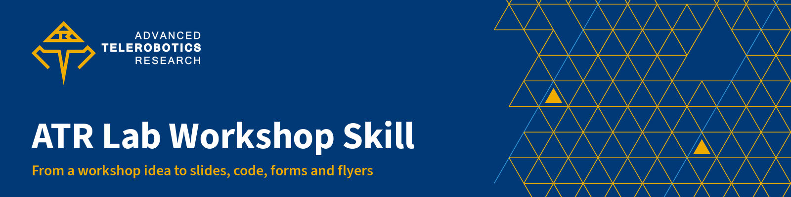
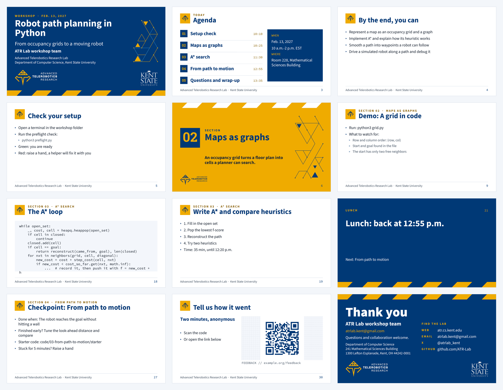
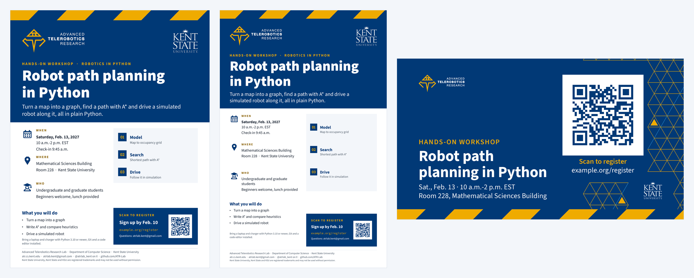

<p align="center">
  
</p>

<p align="center">
  
  
  
  
  
  
</p>

# ATR Lab Workshop Skill

**`atr-lab-workshop`** is a [Claude skill](https://docs.claude.com/en/docs/agents-and-tools/agent-skills/overview)
(it works in Codex too) that plans and builds a complete academic workshop for the **Advanced Telerobotics Research
Lab** at Kent State University, on whatever topic a researcher wants to teach. Describe the workshop in plain
words. Claude interviews you for anything missing, plans the day with you, then builds every asset from one brief
on the lab's brand system and checks it before handing it over.

You tell it:

- **where** the workshop is (building and room, or online)
- **when** it is (date, start and end time)
- **the main topics** it covers
- **what participants need** (skills, laptops, boards, software, accounts)
- **anything else** to include or avoid (food, helpers, a repo to build on, accessibility, tone)

You get back:

| Deliverable | Format |
|---|---|
| Detailed outline of the workshop's material | `outline.md` |
| Schedule: talks, demos, hands-on, breaks, lunch, Q&A, with clock times | `schedule.md`, `schedule.csv`, `workshop.ics` |
| Presentation slides | PowerPoint `.pptx` and tagged PDF |
| Speaker notes in bullet form for every slide | in the `.pptx` and `slides/speaker-notes.md` |
| The code used in the workshop | `code/`: README, setup check, starter and solution per activity, tests |
| Google Form file to import into Google Forms (registration and feedback) | `forms/create-forms.gs` with a step-by-step `IMPORT.md` |
| Paper flyers | Letter (and Tabloid or 17 × 22 in) as PDF, PPTX and PNG, with a registration QR code |
| Hallway TV promo slide | 1920 × 1080 JPEG (and a looping MP4 on request) |

Slides and promotion are built by the **[atr-lab-design](https://github.com/ATR-Lab/atr-lab-design-skill)**
skill, so they use the lab's templates, Kent State colors and fonts, verified facts and the design skill's
linter, renderer and QR checks. **Install it first.**

> [!NOTE]
> Google Forms cannot import a file. The "Google Form file" is a Google Apps Script: paste it into
> script.google.com, press Run, and it creates the forms in your Drive and prints their links. Give the links back
> to Claude and it puts them on the flyers, the TV slide and the feedback slide.

## Contents

- [Install the Claude Code plugin](#install-the-claude-code-plugin)
- [Or install with one prompt](#or-install-with-one-prompt)
- [Other ways to install](#other-ways-to-install)
- [Requirements](#requirements)
- [Use it](#use-it)
- [What it makes](#what-it-makes)
- [How it works](#how-it-works)
- [Scripts cheat sheet](#scripts-cheat-sheet)
- [What's inside](#whats-inside)
- [Keep it current](#keep-it-current)
- [For maintainers](#for-maintainers)
- [Credits and licenses](#credits-and-licenses)

---

## Install the Claude Code plugin

In **Claude Code** (a terminal or the Code tab of the Claude desktop app), install the design plugin and then
this one:

```text
/plugin marketplace add ATR-Lab/atr-lab-design-skill
/plugin install atr-lab-design@atr-lab
/atr-lab-design:setup
/plugin marketplace add ATR-Lab/atr-lab-workshop-skill
/plugin install atr-lab-workshop@atr-lab-workshop
/atr-lab-workshop:setup
```

Restart Claude Code after installing (skills load at startup). The skill triggers on its own whenever you ask for a
workshop. The commands call it explicitly:

| Command | What it does |
|---|---|
| `/atr-lab-workshop:workshop <topic, date, place, audience, needs>` | Interviews you, plans the workshop and builds the whole package |
| `/atr-lab-workshop:forms-ready <links from the Apps Script log>` | Puts the real form links on the flyers, TV slide and feedback slide and rebuilds |
| `/atr-lab-workshop:revise <change>` | Changes a fact, the schedule or the slides and rebuilds only what it reaches |
| `/atr-lab-workshop:status [folder]` | Lists the deliverables and everything still needed before sharing |
| `/atr-lab-workshop:setup` | Checks this plugin, the design plugin and the render tools |

**Update** with `/plugin marketplace update atr-lab-workshop`, then `/plugin update atr-lab-workshop@atr-lab-workshop`
if your Claude Code doesn't update plugins automatically.

## Or install with one prompt

To install from a git clone instead (so you can edit the skill or pull changes yourself), copy this into Claude
Code or Codex. Use one install method, not both, or the skill loads twice.

```text
Install the ATR Lab workshop skill for me as a personal skill.

1. It needs the ATR Lab design skill. Check for ~/.claude/skills/atr-lab-design/SKILL.md (or the
   atr-lab-design Claude Code plugin). If neither is there, install the design skill first by following
   the "Or install with one prompt" section of https://github.com/ATR-Lab/atr-lab-design-skill.
2. Clone the workshop skill with
   `git clone --depth 1 https://github.com/ATR-Lab/atr-lab-workshop-skill.git ~/.local/share/atr-lab-workshop-skill`,
   or run `git -C ~/.local/share/atr-lab-workshop-skill pull` if that folder already exists.
   On Windows, use %LOCALAPPDATA%\atr-lab-workshop-skill instead.
3. Symlink ~/.claude/skills/atr-lab-workshop to the atr-lab-workshop folder inside the clone (create
   ~/.claude/skills if needed). If I use Codex, also symlink ~/.codex/skills/atr-lab-workshop and make sure
   ~/.codex/skills/atr-lab-design exists the same way. If a target already exists and isn't that symlink,
   ask me before replacing it. Without symlinks (Windows without developer mode), copy the folder.
4. Verify: read ~/.claude/skills/atr-lab-workshop/SKILL.md, then run
   `python3 ~/.claude/skills/atr-lab-workshop/scripts/workshop.py doctor`. It must print "ready". If it
   reports something missing, tell me the fix; don't install system software yourself.
5. Tell me it's ready, where it lives and how to update it, and suggest a first workshop request.
```

**Update later:** *"Update my ATR Lab workshop skill: run `git -C ~/.local/share/atr-lab-workshop-skill pull` and
tell me what changed."*

> [!TIP]
> Working **inside this repository**? `.claude/skills/atr-lab-workshop` is a committed link to the skill, so Claude
> Code loads it for any session opened here (the design skill must still be installed).

## Other ways to install

<details>
<summary><b>Claude Code or Codex, by hand</b></summary>

```bash
git clone --depth 1 https://github.com/ATR-Lab/atr-lab-workshop-skill.git ~/.local/share/atr-lab-workshop-skill
mkdir -p ~/.claude/skills
ln -sfn ~/.local/share/atr-lab-workshop-skill/atr-lab-workshop ~/.claude/skills/atr-lab-workshop
# Codex reads ~/.codex/skills
mkdir -p ~/.codex/skills
ln -sfn ~/.local/share/atr-lab-workshop-skill/atr-lab-workshop ~/.codex/skills/atr-lab-workshop
python3 ~/.claude/skills/atr-lab-workshop/scripts/workshop.py doctor
```

The scripts find the design skill next to this one, in `~/.claude/skills`, `~/.codex/skills`, the Claude Code
plugin cache, or wherever `ATR_DESIGN_SKILL` points; and its Python in its `.venv`, the plugin's data folder, or
`ATR_DESIGN_PYTHON`.
</details>

<details>
<summary><b>Claude Code, for one project (the whole team gets it)</b></summary>

```bash
mkdir -p .claude/skills
cp -R ~/.local/share/atr-lab-design-skill/atr-lab-design .claude/skills/
cp -R ~/.local/share/atr-lab-workshop-skill/atr-lab-workshop .claude/skills/
```

Commit both folders (without `.venv`); each teammate creates the design skill's venv once.
</details>

<details>
<summary><b>Claude.ai (web and desktop chat)</b></summary>

Upload the design skill's zip first (its README explains it), then this one:

```bash
cd ~/.local/share/atr-lab-workshop-skill
zip -r atr-lab-workshop.zip atr-lab-workshop -x '*.DS_Store' '*__pycache__*'
```

In **Settings → Capabilities**, turn on code execution and upload the zip under **Skills**. In the Claude.ai
sandbox the intake, outline, schedule, forms, code and deck specs work (standard-library Python). Building and
rendering the slides and flyers needs the design skill's packages and LibreOffice, which the sandbox may not
have; when it can't render, the skill says so and hands you the specs to build on a machine that can.
</details>

## Requirements

| What | Needed for | Install |
|---|---|---|
| Python 3.9+ (standard library) | Everything in this skill | already on macOS and Linux; python.org on Windows |
| [atr-lab-design](https://github.com/ATR-Lab/atr-lab-design-skill) 2.2+ with its Python packages | Slides, flyers, TV slide, PDF export, QR checks, linting | its README (`/atr-lab-design:setup` for the plugin) |
| LibreOffice and poppler | Rendering and PDF export (via the design skill) | macOS `brew install --cask libreoffice && brew install poppler` · Debian/Ubuntu `apt install libreoffice poppler-utils` |
| Node.js (optional) | Testing the Google Forms script offline | [nodejs.org](https://nodejs.org) |
| A Google account | Running the forms script (the presenter does this) | |

## Use it

Just ask. The skill triggers on any request to plan, prepare, run or promote a workshop, tutorial, hands-on
session, bootcamp or short course, even when you ask for one piece of it.

| You want | Try asking |
|---|---|
| A whole workshop | *"Plan a four-hour hands-on workshop on robot path planning in Python for undergrads, Saturday Feb. 13, 10 a.m.-2 p.m. in MSB 228. They need a laptop with Python 3.10. 24 seats, lunch provided."* |
| A thin start | *"I want to run a workshop on reinforcement learning next month."* (Claude asks what it needs in one round.) |
| A hardware workshop | *"A 3-hour intro to ROS 2 with our six TurtleBots for grad students, March 6, 1-4 p.m. Laptops with Docker. Pairs."* |
| Virtual | *"A 90-minute Zoom tutorial on our telepresence dataset for collaborators, April 2 at 2 p.m."* |
| After you made the forms | *"Here are the form links from the log: ..."* or `/atr-lab-workshop:forms-ready ...` |
| A change | *"Move it to Room 204 and add a Tabloid flyer."* · *"Give the A\* part 15 more minutes."* |
| Before sharing | *"Swap in the official Kent State logo."* · *"What's still missing?"* · *"Zip the package."* |

**What happens.** Claude reads the skill, writes what you told it into `workshop.json` and asks, in one round,
for anything missing: the facts above, plus seats, presenters, deadlines, and always *"anything else you want the
workshop to include or avoid?"*. It drafts the objectives, modules and schedule and checks them with you. Then it
writes and tests the code, writes the slides and speaker notes, makes the forms, builds everything, looks at every
rendered page and finishes with:

- the deliverables, with their paths
- what it checked (source checks, checks of the exported PDFs, tests run)
- the assumptions it made
- a **"still needed from you"** list: create the forms and send back the links, swap in the official Kent State
  logo, confirm placeholders, approvals for printing and the TV slideshow, phone scans of printed QR codes

**Tips for better results:**

- **Give the facts you have.** Date, time, room, audience, what to bring. Claude never invents a room, a person or a
  link; anything unknown stays a visible `[placeholder]`.
- **Say how hands-on.** "Mostly building" and "mostly talks with demos" give very different schedules.
- **Point it at existing material.** A repository, old slides or a syllabus: Claude builds on them.
- **Ask for a draft** to see the shape early (`workshop.py build --draft`); drafts are never for printing.

## What it makes

The example below ships in [`atr-lab-workshop/examples/path-planning/`](atr-lab-workshop/examples/path-planning/):
a four-hour workshop with three modules, built end to end. Its date and room are sample values, and its QR codes
point at `example.org` until real forms exist, as every workshop's do.

### Slides with speaker notes

<p align="center"></p>

The deck follows the schedule: logistics, an agenda with start times, objectives, a setup check, then per module
a section divider, concept slides, a demo, code slides (editable Source Code Pro), the hands-on task and a
checkpoint; break and lunch slides with return times; Q&A, wrap-up, a feedback QR slide and thank you. Every slide
has 2-6 speaker-note bullets (say, do, ask, timing, fallback), collected in `slides/speaker-notes.md`.

### Flyers and the hallway TV slide

<p align="center"></p>

Built on the design skill's event-flyer templates (Letter, Tabloid, 17 × 22 in) and its signage preset, with the
QR code generated at its printed size and decoded back from the exported PDF and the TV image.

### Code, schedule and forms

- **Code:** one folder per activity with `starter/` (the task as a stub), `solution/` and tests that pass on the
  solution and fail on the starter; a participant README; and `preflight.py`, a standard-library setup check
  driven by `preflight.json` that prints PASS/FAIL with a fix per line.
- **Schedule:** clock times in Kent State style, time by kind, pacing checks (a break at least every 90 minutes,
  talks of 30 minutes or less, a meal for four hours or more, Q&A, an early setup check) and a calendar file.
- **Forms:** registration (contact, a comfort grid built from the prerequisites, setup readiness, accommodations,
  photo preference, dietary needs, your extra questions; closes itself at capacity) and feedback (usefulness,
  objectives met, pace, hands-on, comments), previewed in `forms-preview.md`.

## How it works

```
your request ──► workshop.json ──► check ──► questions ──► workshop.json (complete)
                                                              │
         ┌────────────────┬───────────────┬──────────────────┼──────────────────┬────────────────┐
         ▼                ▼               ▼                  ▼                  ▼                ▼
     outline.md     schedule.md      code/ (tested)    slides/deck.json   forms/*.form.json   promotion
                     .csv .ics                                │                  │            facts
                                                              ▼                  ▼               │
                                          atr-lab-design: new_deck.py,   create-forms.gs         ▼
                                          project.py, banner.py ─────► .pptx .pdf flyers TV slide, QR checks
```

One brief feeds everything, so a change (a new room, the real registration link) is one `workshop.py set` and one
`workshop.py build`; only the affected files are rebuilt and re-exported.

## Scripts cheat sheet

Run from `atr-lab-workshop/` (any Python 3.9+):

```bash
python3 scripts/workshop.py doctor                          # find the design skill, its Python, LibreOffice
python3 scripts/workshop.py init ~/work/my-workshop         # blank brief (or --example path-planning)
python3 scripts/workshop.py check -w ~/work/my-workshop     # what to ask the presenter (--json for agents)
python3 scripts/workshop.py set when.date 2027-02-13 -w ~/work/my-workshop
python3 scripts/workshop.py schedule -w ~/work/my-workshop  # schedule.md/.csv, workshop.ics, pacing checks
python3 scripts/workshop.py outline -w ~/work/my-workshop   # outline.md draft
python3 scripts/workshop.py code -w ~/work/my-workshop      # code/ scaffold
python3 scripts/workshop.py deck skeleton -w ~/work/my-workshop    # slides/deck.json from the schedule
python3 scripts/workshop.py deck notes -w ~/work/my-workshop       # speaker-notes.md and the notes check
python3 scripts/workshop.py forms init -w ~/work/my-workshop       # registration and feedback specs
python3 scripts/workshop.py forms build -w ~/work/my-workshop      # create-forms.gs, preview, IMPORT.md
python3 scripts/workshop.py build -w ~/work/my-workshop [--draft] [--changed-only]
python3 scripts/workshop.py official-logos -w ~/work/my-workshop   # official Kent State wordmark, re-export
python3 scripts/workshop.py status -w ~/work/my-workshop           # deliverables and what is still needed
python3 scripts/workshop.py bundle -w ~/work/my-workshop           # one zip for hand-off
```

Exit status: 0 done, 1 usage or brief error, 2 refused (questions still open; `--draft` builds anyway), 3 a build
or check failed.

## What's inside

```
atr-lab-workshop/              the skill (the only folder Claude needs)
├── SKILL.md                   entry point: deliverables, workflow, intake, QA gate, rules
├── references/                intake, brief-schema, workshop-design, schedule, slides-and-notes,
│                              code-materials, google-forms, promotion, qa-and-handoff
├── assets/templates/          create-forms.gs.tmpl, IMPORT-FORMS.md, preflight.py, code-README.md
├── examples/path-planning/    a finished workshop: brief, outline, deck.json and tested code
└── scripts/
    ├── workshop.py            the front door
    ├── wslib/                 brief, schedule, outline, deck, forms, code, design, status
    └── tests/                 pytest suite and the Apps Script mock (Node)
```

The repository around it holds:

- `.claude-plugin/`: `plugin.json` (the plugin, which points at `atr-lab-workshop/`) and `marketplace.json` (the
  `atr-lab-workshop` marketplace that `/plugin marketplace add` reads)
- `commands/`: the plugin's slash commands (`workshop`, `forms-ready`, `revise`, `status`, `setup`)
- `.claude/skills/atr-lab-workshop`: a link that loads the skill in any Claude Code session opened here
- this README, its images (`.github/images/`), `CHANGELOG.md` and `AGENTS.md`

A workshop folder the skill builds looks like this:

```
my-workshop/
├── workshop.json   README.md (index + still needed)   outline.md   schedule.md .csv   workshop.ics
├── slides/         deck.json   speaker-notes.md
├── code/           README.md   preflight.py   preflight.json   01-.../{starter,solution}/
├── forms/          registration.form.json   feedback.form.json   create-forms.gs   forms-preview.md   IMPORT.md
├── deliverables/   atr-deck-*.pptx .pdf   atr-flyer-*-letter.pdf .pptx .png   atr-tv-*.jpg   qa-report.md
└── design/         the design skill's project (generated; renders in design/work/qa/)
```

## Keep it current

- **Brand, facts and templates** live in the design skill; update it (`git pull` or `/plugin update`) and rebuild.
- **The forms builder** uses Google Apps Script's `FormApp`. If Google changes publishing or email collection,
  update `assets/templates/create-forms.gs.tmpl` and the mock in `scripts/tests/mock_apps_script.js` together.
- **After any change** to the scripts, run the tests from `atr-lab-workshop/`:
  `python3 -m pytest -q -p no:cacheprovider scripts/tests` (or `uvx pytest ...`), then rebuild the example:
  `python3 scripts/workshop.py init /tmp/ex --example path-planning && python3 scripts/workshop.py code -w /tmp/ex
  && python3 scripts/workshop.py build -w /tmp/ex` and look at the renders.

## For maintainers

- **Releasing a plugin update:** bump `version` in [`.claude-plugin/plugin.json`](.claude-plugin/plugin.json) and add
  a [CHANGELOG](CHANGELOG.md) entry; Claude Code compares versions. Check the manifests with
  `claude plugin validate .` and try a checkout with `claude --plugin-dir .`.
- **Regenerating the README images:** build the example (above), then compose `gallery-slides.png` from pages 1, 3,
  4, 5, 6, 9, 18, 19, 21, 27, 30 and 31 of `design/work/qa/deck/` and `gallery-promo.png` from the two flyer PNGs
  and the TV JPEG in `deliverables/`; the banner is `banner.py --preset github-header`.
- Keep the skill standard-library only; anything that needs packages belongs in the design skill.

## Credits and licenses

- **Brand, templates, logos and fonts** come from the atr-lab-design skill, under its terms. The KENT STATE
  UNIVERSITY wordmark is a registered trademark of Kent State University; use the official files
  (`workshop.py official-logos`) for anything shared.
- **The skill's own license** is to be decided by the lab.

<p align="center"><sub>Advanced Telerobotics Research Lab · Department of Computer Science · Kent State University · <a href="https://www.atr.cs.kent.edu/">www.atr.cs.kent.edu</a></sub></p>
